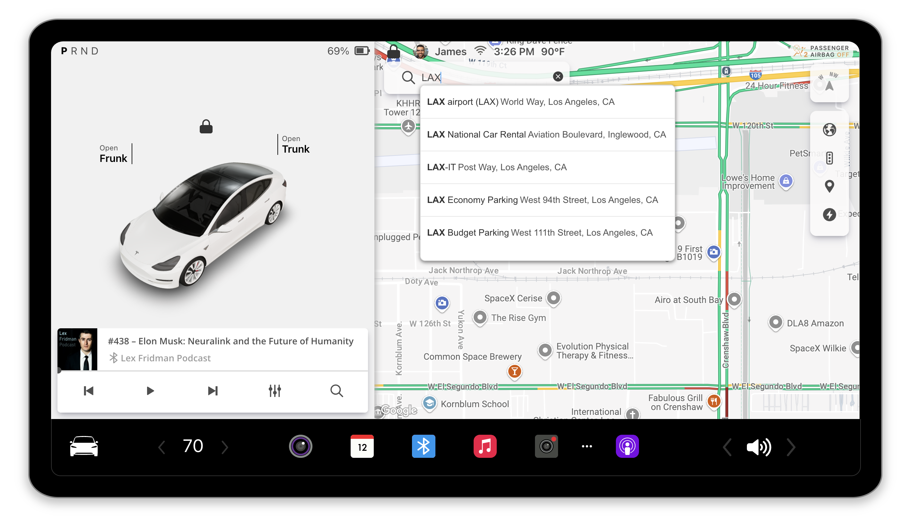

# Tesla Infotainment Simulator (WIP)

Experience a simulated Tesla infotainment system in your browser!

[Live Demo](https://jamesalmeida.github.io/tesla-infotainment/)



## Features to try out

- Realistic 3D model of Tesla Model Y. Try opening the trunk and frunk!
- Interactive infotainment system simulation. Play a podcast, adjust the volume, etc.
- Put the car in reverse (Click the R) and see what's behind you!
- Try searching on the map. Turn on traffic or different map styles.
- Check out the keyboard shortcuts below for more controls.
- Working on more responsive design for various screen sizes. Works best on desktop but you can try it out on your phone in landscape mode too.
- Adding features periodically. Leave a feature request in the issues section ^_^

## Keyboard Shortcuts

- Shift + Left Arrow: Toggle left turn signal
- Shift + Right Arrow: Toggle right turn signal
- Shift + H: Toggle hazard lights
- Shift + F: Toggle frunk (front trunk)
- Shift + T: Toggle trunk
- Shift + M: Focus on Navigate Input
- Shift + C: Backup Camera

### Gear Selection

- P: Park
- R: Reverse
- N: Neutral
- D: Drive

### Music Controls

- Space: Play/Pause
- Shift + <: Previous track
- Shift + >: Next track

## Quick Start

To run the project locally:

1. Clone the repository:

   ```
   git clone https://github.com/jamesalmeida/tesla-infotainment.git
   cd tesla-infotainment
   ```

2. Use Node.js 24 or newer (the version is pinned in `.node-version`), then install dependencies with [pnpm](https://pnpm.io/). The pnpm version is pinned in `package.json`; `npm install -g corepack && corepack enable` picks it up automatically (Node.js 25+ no longer bundles corepack):

   ```
   pnpm install
   ```

3. Use the `.env.template` to create your own `.env` file. Add your API key for [Google Maps](https://cloud.google.com/maps-platform) and also a mapID for the maps styles to match Tesla's car maps. You can use mine (it's in the template) or create your own.

4. Start the development server:

   ```
   pnpm dev
   ```

5. Open [http://localhost:3000/tesla-infotainment/](http://localhost:3000/tesla-infotainment/) in your browser.

## Build for Production

To create a production-ready build:

```
pnpm build
```

This command builds the app for production to the `dist` folder, optimizing the build for the best performance.

## Linting

To check the code for problems:

```
pnpm lint
```

Use `pnpm lint:fix` to apply the automatically fixable ones.

## Type checking

The app is written in TypeScript (strict mode). To type-check it without building:

```
pnpm typecheck
```

## Formatting

Code is formatted with [Prettier](https://prettier.io/), and CI fails on unformatted files:

```
pnpm format
```

Use `pnpm format:check` to check without writing.

## Tests

The UI-flow tests run with Vitest in a jsdom environment:

```
pnpm test
```

Use `pnpm test:watch` while developing.

## Deployment

Every push to `main` is linted, type-checked, tested, built and deployed to GitHub Pages by `.github/workflows/main.yml`. The GitHub Pages base path is configured in `vite.config.mjs`.

This project is built with [Vite](https://vite.dev/).

## 3D model

The car model in `public/car-models/` is compressed with [glTF Transform](https://gltf-transform.dev/) (meshopt geometry, WebP textures), which drei's `useGLTF` decodes out of the box. To compress a new or updated model:

```
npx @gltf-transform/cli optimize input.glb output.glb \
  --compress meshopt --texture-compress webp \
  --flatten false --join false --instance false \
  --simplify false --palette false --prune-solid-textures false
```

The `false` flags keep the node names and hierarchy that `VehicleModel.tsx` looks up (`bonnet_dummy`, `boot_dummy`, `door_*_dummy`) and keep the glass textures intact.

### Thanks

- Want to thank Ameer Studio for sharing the [3D model of the Tesla Model 3](https://sketchfab.com/3d-models/tesla-2018-model-3-5ef9b845aaf44203b6d04e2c677e444f) I'm using in the simulator.
- Also thanks to Vasilj Miloevi for the [loading screen circle animations](https://codepen.io/eboye/pen/ANPxVX) that I used for the loading screen.
- Thanks to Patrick Stillhart for sharing the [OutRun video game on Codepen](https://codepen.io/arcs/pen/aGzNKY) that I refactored to work inside of the Arcade in this project.

## License

This repository's code is licensed under the [MIT License](LICENSE). Anyone may use, copy, modify, merge, publish, distribute, sublicense, and/or sell copies of the Software, provided the copyright notice and permission notice are retained.

Third-party assets credited above still have their own terms until replaced (issues #4, #5, #6). MIT covers James's code only — not these assets:

- Sketchfab Tesla 2018 Model 3 by Ameer Studio (CC-BY) — `public/car-models/tesla-model-3-2018.glb`
- Loading-screen circles from CodePen (eboye/ANPxVX)
- OutRun arcade from CodePen (arcs/aGzNKY) plus hotlinked S3 assets
